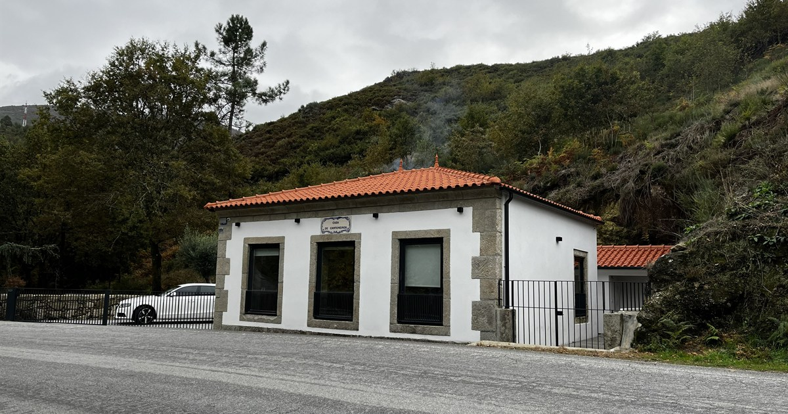

<p align="center">
  
</p>

<h1 align="center">Casa de Cantoneiros</h1>

<p align="center">
  <strong>Turismo rural em Campos Ruivães, Vieira do Minho — no coração do Gerês.</strong><br>
  Website institucional e sistema de reservas com cálculo automático de tarifas.
</p>

<p align="center">
  <a href="https://casadecantoneiros.pt"><strong>🌐 Visitar o site em produção</strong></a>
</p>

<p align="center">
  
  
  
  
</p>

<p align="center">
  
  
  
  
</p>

---

## 📖 Sobre o projeto

A **Casa de Cantoneiros** é um alojamento de turismo rural instalado numa antiga casa de
cantoneiros, restaurada para receber com calma, conforto e autenticidade. Este repositório
contém o website público do alojamento, construído de raiz com **HTML5, CSS3 e JavaScript
puro**, sem frameworks de front-end nem etapas de build.

O grande destaque técnico é o **sistema de reservas**: o visitante escolhe as datas, vê
imediatamente o preço da estadia (com tarifas por época e desconto progressivo) e envia o
pedido por **Web3Forms**. Toda a lógica de preços e regras de estadia está centralizada num
único ficheiro de configuração, evitando inconsistências entre páginas.

> **Foco de engenharia:** simplicidade operacional, validação em dupla camada, acessibilidade,
> SEO técnico e uma experiência móvel cuidada — sem dependências desnecessárias.

---

## ✨ Funcionalidades principais

| Área | Funcionalidade |
| --- | --- |
| 🏡 **Institucional** | Página inicial, história da casa, galeria, contactos, reservas e política de privacidade. |
| 📅 **Reservas** | Formulário completo com nome, contacto, datas, adultos, crianças e notas. |
| 💶 **Simulador de preços** | Cálculo automático por noite, por época e com desconto de longa estadia. |
| 🛏️ **Regras de estadia** | Mínimo de **2 noites**, máximo de **60 noites** e bloqueio de datas inválidas. |
| 🖼️ **Galeria dinâmica** | 31 fotografias originais, filtros por categoria e lightbox Fancybox. |
| 📱 **Responsive Design** | Layout adaptado a desktop, tablet e telemóvel; simulador reposicionado em mobile. |
| ✉️ **Formulários** | Envio via Web3Forms com honeypot anti-spam e redirecionamento pós-envio. |
| ⚙️ **Configuração central** | Tarifas, descontos, contactos e versão de assets em `js/site-config.js`. |
| 🔍 **SEO técnico** | JSON-LD `LodgingBusiness`, Open Graph, `sitemap.xml`, `robots.txt` e manifest. |
| 🔒 **Privacidade** | Banner de cookies com consentimento persistente e página dedicada. |
| ♿ **Acessibilidade** | Labels associados, `aria-*`, alts descritivos e navegação por teclado. |

---

## 💰 Como funciona o simulador de preços

O simulador lê as datas de check-in e check-out, conta as noites e aplica a tarifa de cada
noite conforme o mês. Estadias de **7 ou mais noites** recebem **10% de desconto** sobre o
total. O valor final é enviado no campo oculto `estimativa_preco`.

### Regras de negócio

| Regra | Valor |
| --- | ---: |
| Estadia mínima | **2 noites** |
| Estadia máxima | **60 noites** |
| Época baixa | Outubro a maio |
| Época alta | Junho a setembro |
| Tarifa de época baixa | **130 € / noite** |
| Tarifa de época alta | **150 € / noite** |
| Desconto de longa estadia | **10%** a partir de **7 noites** |

### Exemplos validados

| Cenário | Noites | Cálculo | Total |
| --- | ---: | --- | ---: |
| 2 noites em época baixa | 2 | `2 × 130 €` | **260 €** |
| 2 noites em época alta | 2 | `2 × 150 €` | **300 €** |
| 7 noites em época baixa | 7 | `7 × 130 € − 10%` | **819 €** |
| 7 noites entre maio e junho | 7 | `2 × 130 € + 5 × 150 € − 10%` | **909 €** |
| 1 noite | 1 | Abaixo do mínimo | **Bloqueado** |
| 69 noites | 69 | Acima do máximo | **Bloqueado** |

> Os valores acima fazem parte da auditoria funcional automatizada do projeto.

---

## 🧱 Stack técnica

| Camada | Tecnologias |
| --- | --- |
| **Estrutura** | HTML5 semântico, meta tags, JSON-LD |
| **Estilo** | CSS3, Flexbox, CSS Grid, variáveis CSS, media queries |
| **Comportamento** | JavaScript ES6+ (vanilla), jQuery para datepicker e plugins |
| **Componentes** | Parciais HTML em `components/` carregados via `fetch` |
| **Galeria** | Fancybox + dados gerados automaticamente com Python e Pillow |
| **Formulários** | Web3Forms (`POST`), validação HTML5 + JavaScript |
| **SEO** | Open Graph, `sitemap.xml`, `robots.txt`, `site.webmanifest` |
| **Ferramentas** | Python 3, Pillow, Node.js (servidor local opcional) |

### Destaques de implementação

- **Sem build step:** o site corre diretamente a partir de ficheiros estáticos.
- **Fonte única de verdade:** tarifas, regras e contactos vivem em `js/site-config.js`.
- **Validação em dupla camada:** restrições HTML5 (`required`, `pattern`, `min`, `max`) e
  validação JavaScript com mensagens em português.
- **Sincronização do simulador:** campos limpos programaticamente disparam eventos para
  manter o preço e o campo oculto sempre coerentes.
- **Assets versionados:** CSS e JS usam `?v=20261108-3` para invalidar cache em produção.
- **Progressively enhanced:** a página continua legível mesmo se algum script falhar.

---

## 🗂️ Estrutura do projeto

```text
CasaDeCantoneiros/
├── index.html                  # Página inicial
├── sobre.html                  # História e apresentação da casa
├── galeria.html                # Galeria com filtros e lightbox
├── reservas.html               # Formulário + simulador de preços
├── contactos.html              # Contactos, mapa e formulário
├── privacidade.html            # Política de privacidade e cookies
├── robots.txt                  # Diretivas para motores de busca
├── sitemap.xml                 # Mapa do site
├── site.webmanifest            # Manifest PWA / ícones
├── README.md                   # Este documento
│
├── components/
│   ├── cabecalho.html          # Header reutilizável
│   └── rodape.html             # Footer reutilizável
│
├── css/
│   ├── style.css               # Base e componentes
│   ├── layout.css              # Estrutura e grelha
│   ├── professional.css        # Refinamento visual
│   ├── animacoes.css           # Animações e transições
│   ├── calendario.css          # Datepicker
│   ├── popup.css               # Lightbox Fancybox
│   └── _custom.css             # Ajustes finais
│
├── js/
│   ├── app.js                  # Componentes, validação, simulador e cookies
│   ├── site-config.js          # Tarifas, regras e contactos
│   ├── galeria-dinamica.js     # Filtros e renderização da galeria
│   ├── gallery-data.js         # Dados gerados das 31 imagens
│   ├── calendario.js           # Datepicker
│   ├── animacoes.js            # AOS e animações
│   ├── parallax.js             # Efeitos de parallax
│   ├── popup.js                # Fancybox
│   └── jquery-*.js             # Dependências locais
│
├── images/
│   ├── assets-site/            # Hero, OG image, favicons e ícones
│   └── galeria/
│       ├── exterior/           # 14 fotografias
│       ├── interior/           # 12 fotografias
│       └── envolvente/         # 5 fotografias
│
├── fonts/                      # Font Awesome local
├── scripts/                    # Automação em Python
│   ├── generate-gallery-data.py
│   ├── generate-favicons.py
│   ├── watch-gallery.py
│   ├── requirements.txt
│   └── README.md
│
└── .gitignore
```

> `robots.txt`, `sitemap.xml` e `site.webmanifest` permanecem na raiz porque têm de ser
> servidos em `https://www.casadecantoneiros.pt/robots.txt`, `.../sitemap.xml` e
> `.../site.webmanifest`.

---

## 🚀 Executar localmente

Os componentes do header e footer são carregados por `fetch`, por isso recomenda-se um
servidor HTTP local (abrir diretamente via `file://` pode bloquear os pedidos).

### Opção 1 — Python

```bash
python -m http.server 8000
```

### Opção 2 — Node.js

```bash
npx serve .
```

Depois abra:

```text
http://localhost:8000
```

### Gerar novamente os dados da galeria

```bash
python -m pip install -r scripts/requirements.txt
python scripts/generate-gallery-data.py
```

O script lê as imagens de `images/galeria/`, gera `js/gallery-data.js` com dimensões e
textos alternativos acessíveis e mantém as categorias `exterior`, `interior` e `envolvente`.

Para regenerar favicons:

```bash
python scripts/generate-favicons.py
```

Documentação detalhada dos scripts: [`scripts/README.md`](scripts/README.md).

---

## ✉️ Fluxo de reserva e Web3Forms

```text
1. O visitante escolhe check-in e check-out
        │
        ▼
2. O simulador calcula noites, tarifas e desconto
        │
        ▼
3. Validação: mínimo 2 noites, máximo 60, datas válidas
        │
        ▼
4. Submit POST para https://api.web3forms.com/submit
   ├── access_key (chave pública Web3Forms)
   ├── subject / from_name / redirect
   ├── estimativa_preco (valor calculado)
   └── botcheck (honeypot anti-spam)
        │
        ▼
5. Web3Forms entrega o pedido por email e redireciona para a homepage
```

> A `access_key` do Web3Forms é pública por design; não é um segredo. O honeypot
> `botcheck` e a validação no cliente reduzem submissões automáticas.

### Campos do formulário de reservas

| Campo | Nome enviado | Validação |
| --- | --- | --- |
| Nome completo | `nome_completo` | Obrigatório |
| Telemóvel | `telemovel` | Obrigatório |
| Email | `email` | Obrigatório, formato de email |
| Check-in | `checkin` | Obrigatório, `DD/MM/AAAA`, não anterior a hoje |
| Check-out | `checkout` | Obrigatório, mínimo 2 e máximo 60 noites |
| Adultos | `adultos` | Pelo menos 1 |
| Crianças | `criancas` | Obrigatório |
| Notas | `notas` | Opcional |
| Estimativa | `estimativa_preco` | Calculada automaticamente |

---

## 🔍 SEO, performance e privacidade

- **Canonical e Open Graph** em todas as páginas, com imagem de partilha `og-share.jpg`.
- **JSON-LD `LodgingBusiness`** na homepage (morada, contactos, horários e preços).
- **`sitemap.xml`** com as seis páginas públicas e `lastmod` atualizado.
- **`robots.txt`** na raiz, com diretivas para motores de busca.
- **`site.webmanifest`** e conjunto completo de favicons.
- **Imagens otimizadas** com `loading="lazy"` e dimensões explícitas na galeria.
- **Fontes e bibliotecas locais** para reduzir dependências externas.
- **Consentimento de cookies** guardado em `localStorage` e cookie de suporte.
- **Política de privacidade** detalhada em `privacidade.html`.

---

## ✅ Qualidade e testes

O projeto foi sujeito a uma auditoria completa antes da publicação:

- ✔️ Navegação desktop e mobile nas seis páginas, sem overflow horizontal.
- ✔️ Zero erros de consola e zero falhas de rede em Chrome headless.
- ✔️ Header e footer carregados corretamente em todas as páginas.
- ✔️ Galeria com 31 imagens, filtros funcionais e lightbox operacional.
- ✔️ Datepicker, selects personalizados e menu móvel testados.
- ✔️ Simulador validado nos cenários de 2, 7 e 69 noites.
- ✔️ Submissão inválida bloqueada (1 noite e 0 adultos).
- ✔️ Submissão válida recebida com todos os campos e `estimativa_preco=260.00`.
- ✔️ Formulário de contacto validado de ponta a ponta.
- ✔️ Banner de cookies: primeira visita, aceitação, persistência e reposição.
- ✔️ HTML, CSS, JavaScript, JSON e XML validados.

---

## 👤 Autor

**Rodrigo Matias**  
Desenvolvimento web, front-end e automação.

Projeto desenvolvido para a **Casa de Cantoneiros — Turismo Rural em Campos Ruivães**.
Website: [casadecantoneiros.pt](https://casadecantoneiros.pt)

---

<p align="center">
  <sub>© Casa de Cantoneiros · Campos Ruivães, Vieira do Minho · Portugal</sub>
</p>
